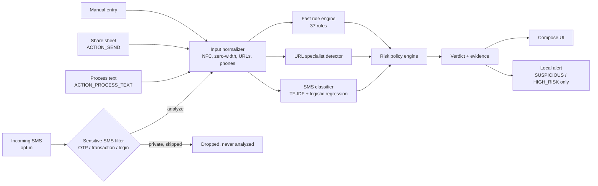
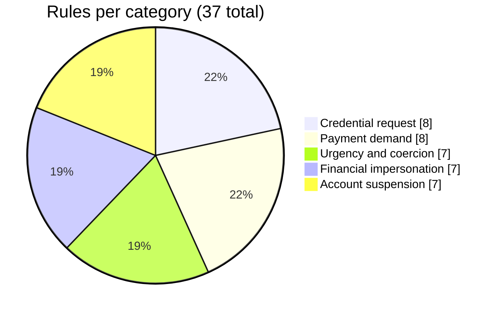
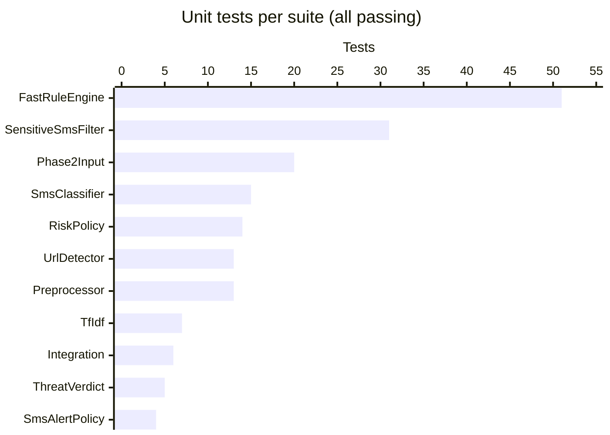
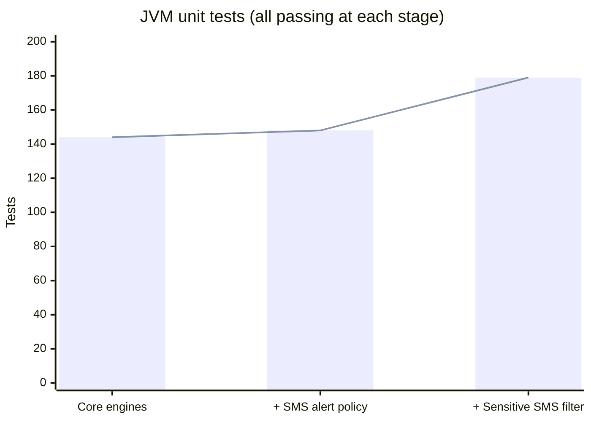
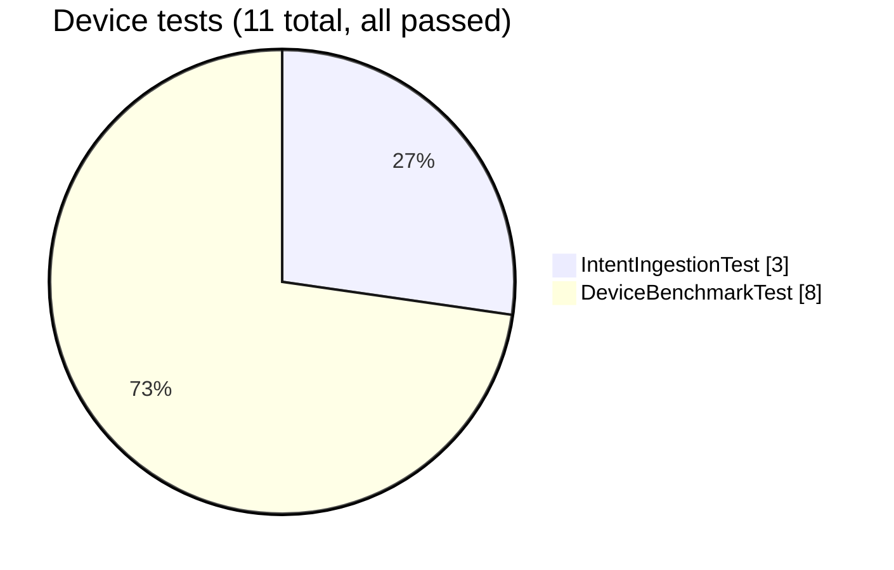

# ARM Digital Safety Guardian

An offline Android app that checks suspicious messages (SMS, chat text, shared text) for scams and phishing. Everything runs **on the device**: the app has no `INTERNET` permission, no analytics and no message logging.

- Package: `com.arm.threatassistant` · Kotlin + Jetpack Compose · minSdk 26, targetSdk 35
- Verdicts: **SAFE**, **SUSPICIOUS**, **HIGH_RISK**, **INSUFFICIENT_EVIDENCE**

---

## How it works



### Detection rules

37 deterministic rules in 5 categories:



The URL detector flags IP-based hosts, link shorteners, suspicious TLDs, homograph (look-alike) domains, unusual ports, encoded characters, misleading URL structure and suspicious domain keywords.

## Features

- **Manual entry, share sheet and process text**: check text from any app
- **Optional SMS protection**: an opt-in receiver checks new SMS on-device and shows a local alert only for SUSPICIOUS or HIGH_RISK messages. Safe messages stay silent.
- **Private SMS are skipped**: OTP, bank transaction and login messages are dropped before analysis. Two kinds are still analyzed: messages asking you to *share* a code/PIN/password, and messages that combine a link with prize or reward wording.
- **Readable alerts**: notifications say "Dangerous" or "Suspicious" instead of internal codes
- **Explainable result**: matched rules, URL signals and evidence behind every verdict

## Privacy & security

- No `INTERNET` permission, no network requests, no analytics
- `RECEIVE_SMS` and `POST_NOTIFICATIONS` are optional and used only by SMS protection
- Message text is never stored or logged; links are never opened automatically
- The original message is kept unchanged; normalization works on a copy

Details: [`docs/PRIVACY_SECURITY.md`](docs/PRIVACY_SECURITY.md)

---

## Testing

### Summary

| Test level | Where it ran | Tests | Result |
|---|---|---:|---|
| JVM unit tests | Windows, JDK 21 (Android Studio JBR) | **179** | ✅ 179 passed, 0 failed, 0 skipped |
| Instrumented tests | vivo V2338, Android 16 (ARM device) | **11** | ✅ 11 passed |
| Debug build | `assembleDebug` | — | ✅ builds (APK 8.9 MB) |
| Lint | `lint` | — | ✅ 0 errors |

### Unit tests per suite

| Suite | Covers | Tests | Failures |
|---|---|---:|---:|
| `FastRuleEngineTest` | All 37 rules, false-positive resistance, Unicode, case and punctuation | 51 | 0 |
| `SensitiveSmsFilterTest` | OTP, transaction and login skipping; share-code and reward-link exceptions | 31 | 0 |
| `Phase2InputTest` | Normalizer, manual/share/process-text adapters, URL and phone extraction | 20 | 0 |
| `SmsSpecialistClassifierTest` | Classifier inference and edge cases; never SAFE without a model | 15 | 0 |
| `RiskPolicyEngineTest` | Verdict logic, thresholds, conflicting evidence | 14 | 0 |
| `UrlSpecialistDetectorTest` | Every URL detection category | 13 | 0 |
| `SmsTextPreprocessorTest` | NFC, tokenization, n-grams | 13 | 0 |
| `TfIdfVectorizerTest` | Vocabulary, IDF, L2 normalization | 7 | 0 |
| `SmsClassifierIntegrationTest` | Classifier + rule engine together | 6 | 0 |
| `ThreatVerdictTest` | Domain models | 5 | 0 |
| `SmsAlertPolicyTest` | Alert only for SUSPICIOUS / HIGH_RISK | 4 | 0 |
| **Total** | **11 suites** | **179** | **0** |



### Test count over the project



### Instrumented tests on a real device

Run on a vivo V2338 (Android 16) on 2026-11-13.

| Suite | Tests | What it checks | Result |
|---|---:|---|---|
| `IntentIngestionTest` | 3 | Share and process-text intents open the app without crashing, including a share with no text | ✅ |
| `DeviceBenchmarkTest` | 8 | Cold first analysis, filter correctness, verdicts, filter and analyzer latency, receiver path, long messages, memory | ✅ |



Device fixes found during this run (both committed):
- `androidx.test:core` pinned to 1.6.1, because the transitive 1.5.0 crashed `ActivityScenario` on the device
- The intent tests target `MainActivity` explicitly, because on a real phone an implicit intent opens the system chooser

### Benchmark numbers

`DeviceBenchmarkTest` writes its timings to logcat under the `ARMBENCH` tag. No timing numbers from the device run were saved yet, so **no latency figures are claimed here**. To record them:

```bash
adb logcat -c
adb shell am instrument -w -e class com.arm.threatassistant.benchmark.DeviceBenchmarkTest \
  com.arm.threatassistant.test/androidx.test.runner.AndroidJUnitRunner
adb logcat -d -s ARMBENCH > armbench.txt
```

Each `STAT|...` line gives the mean, median, p95, p99, min and max in microseconds.

### Not tested yet

| Item | Status |
|---|---|
| Detection accuracy (precision, recall, F1) | ⏳ Needs a real labelled SMS dataset. The bundled model is a small test fixture. |
| Device latency numbers | ⏳ Harness ready, numbers not recorded yet |
| Release build signing | ⏳ Not set up |

---

## Build & test

Requirements: **JDK 21** (Android Studio bundled JBR) and **Android SDK 35** (`sdk.dir` in `local.properties`).

```bash
export JAVA_HOME='C:/Program Files/Android/Android Studio/jbr'   # Windows, bash

./gradlew assembleDebug        # app/build/outputs/apk/debug/app-debug.apk
./gradlew testDebugUnitTest    # 179 JVM unit tests
```

Instrumented tests on a phone (use `adb install` + `am instrument` instead of `connectedAndroidTest`, which uninstalls the app and wipes its settings):

```bash
./gradlew assembleDebug assembleDebugAndroidTest
adb install -r app/build/outputs/apk/debug/app-debug.apk
adb install -r app/build/outputs/apk/androidTest/debug/app-debug-androidTest.apk
adb shell am instrument -w com.arm.threatassistant.test/androidx.test.runner.AndroidJUnitRunner
```

On phones that freeze background apps (such as vivo), run `adb shell cmd deviceidle whitelist +com.arm.threatassistant` first and remove it afterwards.

## Project status

| Phase | Name | Status |
|---|---|---|
| 1 | Domain models | ✅ Complete |
| 2 | Input ingestion and normalization | ✅ Complete |
| 3A | Fast rule engine | ✅ Complete |
| 3B | SMS classifier | ✅ Complete (test fixture model) |
| 3B+ | URL detector | ✅ Complete |
| 4 | Risk policy engine | ✅ Complete |
| 5 | ExecuTorch | Evaluated, not needed (pure Kotlin is enough) |
| 6 | Jetpack Compose UI | ✅ Complete; new theme added, simpler layout in progress |
| 7 | Privacy & security | ✅ Verified |
| 8 | Testing | ✅ 179 unit + 11 device tests pass |
| 9 | SMS protection + private SMS filter | ✅ Complete |

## Documentation

- [`ARCHITECTURE.md`](ARCHITECTURE.md) — architecture and component design
- [`docs/IMPLEMENTATION_STATUS.md`](docs/IMPLEMENTATION_STATUS.md) — per-phase status
- [`docs/PRIVACY_SECURITY.md`](docs/PRIVACY_SECURITY.md) — privacy and security model
- [`docs/TESTING_BENCHMARKING.md`](docs/TESTING_BENCHMARKING.md) — test and benchmark plan
- [`docs/EXECUTORCH_EVALUATION.md`](docs/EXECUTORCH_EVALUATION.md) — ExecuTorch evaluation
- [`docs/ENGINEERING_REPORT.md`](docs/ENGINEERING_REPORT.md) — engineering summary
- [`docs/POST_IMPLEMENTATION_AUDIT.md`](docs/POST_IMPLEMENTATION_AUDIT.md) — audit findings
- [`docs/COMPOSE_DEPENDENCY_DIAGNOSIS.md`](docs/COMPOSE_DEPENDENCY_DIAGNOSIS.md) — dependency and build notes
