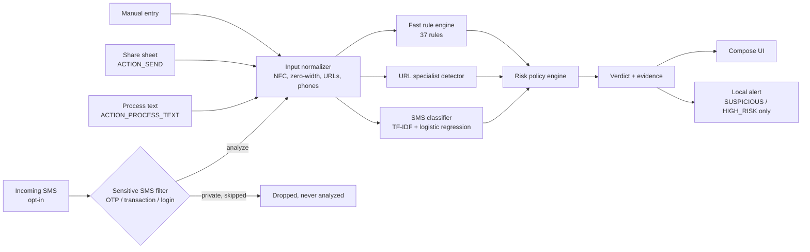
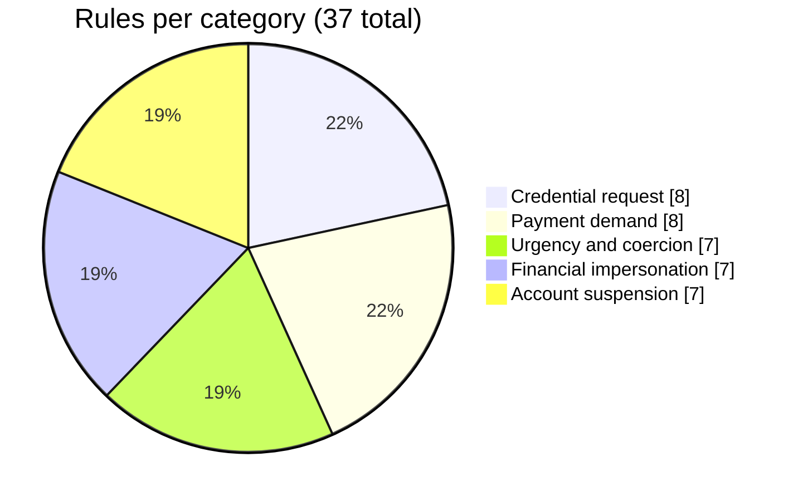
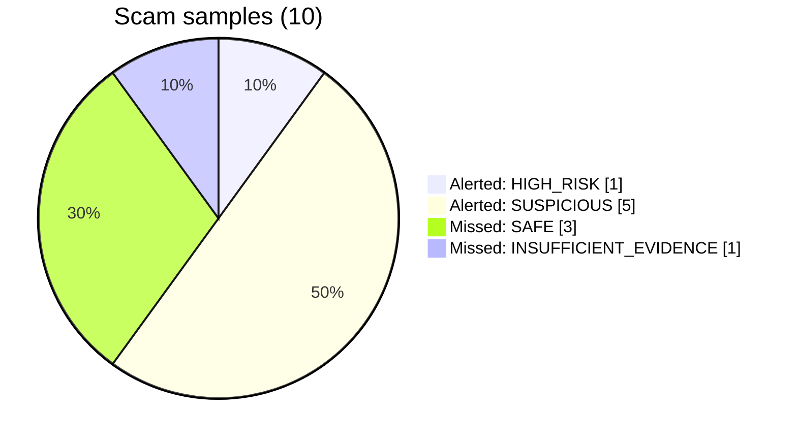

# ARM Digital Safety Guardian

An offline Android app that checks suspicious messages (SMS, chat text, shared text) for scams and phishing. Everything runs **on the device**: the app has no `INTERNET` permission, no analytics and no message logging.

- Package: `com.arm.threatassistant` · Kotlin + Jetpack Compose · minSdk 26, targetSdk 35
- Verdicts: **SAFE**, **SUSPICIOUS**, **HIGH_RISK**, **INSUFFICIENT_EVIDENCE**

---

## How it works



### Detection rules

37 deterministic rules in 5 categories:



The URL detector flags IP-based hosts, link shorteners, suspicious TLDs, homograph (look-alike) domains, unusual ports, encoded characters, misleading URL structure and suspicious domain keywords.

## Features

- **Manual entry, share sheet and process text**: check text from any app
- **Optional SMS protection**: an opt-in receiver checks new SMS on-device and shows a local alert only for SUSPICIOUS or HIGH_RISK messages. Safe messages stay silent.
- **Private SMS are skipped**: OTP, bank transaction and login messages are dropped before analysis. Two kinds are still analyzed: messages asking you to *share* a code/PIN/password, and messages that combine a link with prize or reward wording.
- **Readable alerts**: notifications say "Dangerous" or "Suspicious" instead of internal codes
- **Today tab**: flagged scam and suspicious SMS from the current day, with a live badge; the list clears at local midnight
- **Explainable result**: matched rules, URL signals and evidence behind every verdict

## Privacy & security

- No `INTERNET` permission, no network requests, no analytics
- `RECEIVE_SMS` and `POST_NOTIFICATIONS` are optional and used only by SMS protection
- Message text is never logged; links are never opened automatically. Flagged SMS that need the Today tab are kept in app-private storage only until the local day ends, excluded from backup and then deleted

- The original message is kept unchanged; normalization works on a copy

Details: [`docs/PRIVACY_SECURITY.md`](docs/PRIVACY_SECURITY.md)

---

## Testing

### Summary

| Test level | Where it ran | Tests | Result |
|---|---|---:|---|
| JVM unit tests | Windows, JDK 21 (Android Studio JBR) | **179** | ✅ 179 passed, 0 failed, 0 skipped |
| Instrumented tests | vivo V2338, Android 16, arm64 (2026-11-14) | **11** | ✅ 11 passed |
| Device benchmark | same device | 24 samples, 24,200 timed runs | ✅ completed, measured below |
| Debug build | `assembleDebug` | — | ✅ builds (APK 8.9 MB) |
| Lint | `lint` | — | ✅ 0 errors |

### Unit tests per suite

| Suite | Covers | Tests | Failures |
|---|---|---:|---:|
| `FastRuleEngineTest` | All 37 rules, false-positive resistance, Unicode, case and punctuation | 51 | 0 |
| `SensitiveSmsFilterTest` | OTP, transaction and login skipping; share-code and reward-link exceptions | 31 | 0 |
| `Phase2InputTest` | Normalizer, manual/share/process-text adapters, URL and phone extraction | 20 | 0 |
| `SmsSpecialistClassifierTest` | Classifier inference and edge cases; never SAFE without a model | 15 | 0 |
| `RiskPolicyEngineTest` | Verdict logic, thresholds, conflicting evidence | 14 | 0 |
| `UrlSpecialistDetectorTest` | Every URL detection category | 13 | 0 |
| `SmsTextPreprocessorTest` | NFC, tokenization, n-grams | 13 | 0 |
| `TfIdfVectorizerTest` | Vocabulary, IDF, L2 normalization | 7 | 0 |
| `SmsClassifierIntegrationTest` | Classifier + rule engine together | 6 | 0 |
| `ThreatVerdictTest` | Domain models | 5 | 0 |
| `SmsAlertPolicyTest` | Alert only for SUSPICIOUS / HIGH_RISK | 4 | 0 |
| **Total** | **11 suites** | **179** | **0** |

### Instrumented tests on a real device

First run on a vivo V2338 (Android 16) on 2026-11-13, then re-run on 2026-11-14 with the latest code (11 of 11 passed).

| Suite | Tests | What it checks | Result |
|---|---:|---|---|
| `IntentIngestionTest` | 3 | Share and process-text intents open the app without crashing, including a share with no text | ✅ |
| `DeviceBenchmarkTest` | 8 | Cold first analysis, filter correctness, verdicts, filter and analyzer latency, receiver path, long messages, memory | ✅ |

Device fixes found during this run (both committed):
- `androidx.test:core` pinned to 1.6.1, because the transitive 1.5.0 crashed `ActivityScenario` on the device
- The intent tests target `MainActivity` explicitly, because on a real phone an implicit intent opens the system chooser

### Device benchmark results (measured)

Measured on **vivo V2338, Android 16, arm64-v8a**, debug build, on **2026-11-14**. All 11 instrumented tests passed in 15.7 s.
Raw logs: [`benchmarks/device_benchmark_2026-11-14.txt`](benchmarks/device_benchmark_2026-11-14.txt) and [`benchmarks/instrumented_tests_2026-11-14.txt`](benchmarks/instrumented_tests_2026-11-14.txt).

#### Latency

| Stage | Runs | Mean | Median | p95 | p99 |
|---|---:|---:|---:|---:|---:|
| Sensitive SMS filter | 20,000 | 0.06 ms | 0.05 ms | 0.11 ms | 0.15 ms |
| Incoming SMS path (filter + analysis) | 2,000 | 1.36 ms | 1.51 ms | 2.10 ms | 7.88 ms |
| Full analysis, any message | 2,000 | 2.06 ms | 1.73 ms | 5.26 ms | 7.91 ms |
| Full analysis, scam messages | 838 | 2.22 ms | 1.83 ms | 5.72 ms | 8.11 ms |
| Full analysis, normal messages | 498 | 1.82 ms | 1.52 ms | 5.45 ms | 6.81 ms |
| Full analysis, OTP/bank messages | 664 | 2.04 ms | 1.74 ms | 3.33 ms | 7.68 ms |
| Long message (1,600 characters) | 200 | 7.04 ms | 6.35 ms | 10.65 ms | 14.90 ms |

| Other measurement | Value |
|---|---|
| First analysis after app start (cold) | 33.8 ms |
| Second analysis (warm) | 5.8 ms |
| Incoming SMS throughput | ~738 messages per second |
| Java heap in use | 4.6 MB |
| Native heap | 15.1 MB |
| Debug APK size | 8.9 MB |

#### Filter accuracy on device

The sensitive SMS filter got all **24 of 24** samples right: 10 scams and 6 normal messages were sent on for analysis, and 3 OTP plus 5 bank transaction messages were skipped.

#### Verdicts on 24 sample messages

| Group | Messages | Alerted | Verdicts |
|---|---:|---:|---|
| Scam | 10 | **6** (60%) | 1 HIGH_RISK, 5 SUSPICIOUS, 3 SAFE, 1 INSUFFICIENT_EVIDENCE |
| Normal | 6 | **0** (0% false alarms) | 6 INSUFFICIENT_EVIDENCE |
| OTP / bank | 8 | **0** | 8 skipped by the filter |



**Known gap:** 4 of the 10 scams were missed. They were the "Rs 5000 credited, click this link", "lottery prize, claim at …top", "you won Rs 50000 prize" and "electricity will be disconnected, call officer" messages. These lure and threat patterns aren't covered well by the current rules or by the small test-fixture model. No normal message caused a false alarm.

To repeat the benchmark:

```bash
adb logcat -c
adb shell am instrument -w -e class com.arm.threatassistant.benchmark.DeviceBenchmarkTest \
  com.arm.threatassistant.test/androidx.test.runner.AndroidJUnitRunner
adb logcat -d -s ARMBENCH > armbench.txt
```

### Not tested yet

| Item | Status |
|---|---|
| Detection accuracy on a real dataset (precision, recall, F1) | ⏳ Needs a real labelled SMS dataset. The bundled model is a small test fixture. |
| Missed scam types (prize lures, utility disconnection) | ⏳ Need new rules or a trained model |
| Release build signing | ⏳ Not set up |

---

## Build & test

Requirements: **JDK 21** (Android Studio bundled JBR) and **Android SDK 35** (`sdk.dir` in `local.properties`).

```bash
export JAVA_HOME='C:/Program Files/Android/Android Studio/jbr'   # Windows, bash

./gradlew assembleDebug        # app/build/outputs/apk/debug/app-debug.apk
./gradlew testDebugUnitTest    # 179 JVM unit tests
```

Instrumented tests on a phone (use `adb install` + `am instrument` instead of `connectedAndroidTest`, which uninstalls the app and wipes its settings):

```bash
./gradlew assembleDebug assembleDebugAndroidTest
adb install -r app/build/outputs/apk/debug/app-debug.apk
adb install -r app/build/outputs/apk/androidTest/debug/app-debug-androidTest.apk
adb shell am instrument -w com.arm.threatassistant.test/androidx.test.runner.AndroidJUnitRunner
```

On phones that freeze background apps (such as vivo), run `adb shell cmd deviceidle whitelist +com.arm.threatassistant` first and remove it afterwards.

## Project status

| Phase | Name | Status |
|---|---|---|
| 1 | Domain models | ✅ Complete |
| 2 | Input ingestion and normalization | ✅ Complete |
| 3A | Fast rule engine | ✅ Complete |
| 3B | SMS classifier | ✅ Complete (test fixture model) |
| 3B+ | URL detector | ✅ Complete |
| 4 | Risk policy engine | ✅ Complete |
| 5 | ExecuTorch | Evaluated, not needed (pure Kotlin is enough) |
| 6 | Jetpack Compose UI | ✅ Complete; new theme added, simpler layout in progress |
| 7 | Privacy & security | ✅ Verified |
| 8 | Testing | ✅ 179 unit + 11 device tests pass |
| 9 | SMS protection + private SMS filter | ✅ Complete |

## Documentation

- [`ARCHITECTURE.md`](ARCHITECTURE.md) — architecture and component design
- [`docs/IMPLEMENTATION_STATUS.md`](docs/IMPLEMENTATION_STATUS.md) — per-phase status
- [`docs/PRIVACY_SECURITY.md`](docs/PRIVACY_SECURITY.md) — privacy and security model
- [`docs/TESTING_BENCHMARKING.md`](docs/TESTING_BENCHMARKING.md) — test and benchmark plan
- [`docs/EXECUTORCH_EVALUATION.md`](docs/EXECUTORCH_EVALUATION.md) — ExecuTorch evaluation
- [`docs/ENGINEERING_REPORT.md`](docs/ENGINEERING_REPORT.md) — engineering summary
- [`docs/POST_IMPLEMENTATION_AUDIT.md`](docs/POST_IMPLEMENTATION_AUDIT.md) — audit findings
- [`docs/COMPOSE_DEPENDENCY_DIAGNOSIS.md`](docs/COMPOSE_DEPENDENCY_DIAGNOSIS.md) — dependency and build notes
